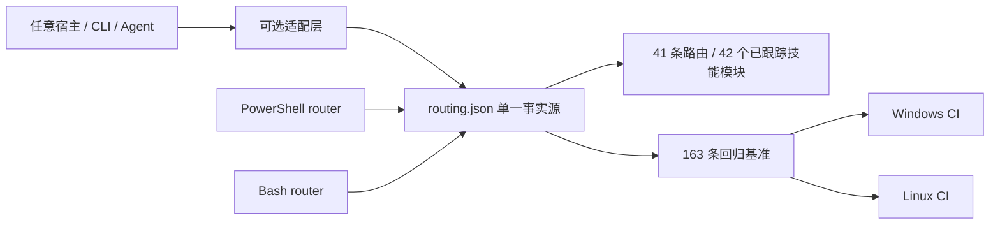

# PR #43 / #37 / #36 / #23 Local Review and Integration Report

- Date: 2026-08-08
- Baseline: `origin/main` at `6315d02`
- Review branch: `codex/review-pr-43-37-36-23`
- Scope: Only review the incremental value of four PRs relative to the current mainline; do not perform external target actions
- Conclusion: All four PRs have reusable value, but only #43 and #37 are suitable for retention; #36 and #23 must be selectively integrated

## Executive summary

| PR | Relative Mainline Value | Integration Decisions | Critical Boundaries |
|---|---|---|---|
| #43 | Very high | Keep structured routing, 163 current regression baselines, dual platform CI, supply chain pin gate, dynamic indexing | Remove OpenCode configuration, installer and dedicated agent; core does not bind any clients |
| #37 | High | Merge case-review, evidence graph review, hash check and single test, and add R40 | Accept both `done` and the currently agreed `completed` |
| #36 | Medium to High | Selective merge of Burp reconnect/newline message processing, atomic token, Anything Analyzer authentication, process tree and sudo home repair | Reject semantic rollbacks such as "all capabilities are ready" |
| #23 | Medium (low overall package) | Merge only Bash case-init, case-guard, structured Bash routing, and CI parity | Exclude client manifests, GIFs, demo spawns, and hardcoded route copies in 92 files |

## Platform Boundary

The only source of truth for structured routing is `references/config/routing.json`. Both the PowerShell and Bash portals read this file; the hosting client is only allowed to exist as an optional adapter and cannot determine the repository identity, routing rules, test bases, or installation paths.

## Review findings and corrections

1. The design value of #43 comes from structured data and automated access control, not OpenCode access. All OpenCode-specific files and CI jobs have been removed.
2. #37 The original implementation only recognizes `done`, and will misjudge `completed` used in the main line as incomplete; it has been supplemented to be compatible with the 7th single test.
3. #36’s bridge reconnection and token writing are net gains; its ability status rewriting will create false positives and is not merged.
4. The Bash router of #23 copies the hard-coded table as it is and will immediately drift with the R40/priority of #43; it has been rewritten to read `routing.json` and verify R1/R3/R40 parity in CI.
5. The new supply-chain gate exposes 7 floating installation sources of Kali manifest. Fixed Frida 14.10.4, IDA MCP commit, Agent Browser 0.31.1, ProxyCat commit, Nuclei v3.8.0, pwntools 4.15.0 and make the install command actually use these pins.
6. A forced review after push found that Bash `case-init` did not inherit the CaseName path constraint; paths, control characters, wildcards, and trailing dots/spaces were rejected, and negative CIs were added.
7. The authorization URL of Bash has been mistakenly fallen into `offline` and may be ready; it has been aligned with PowerShell as `authorized_target_only`, and it is clear that offline only accepts local samples.
8. Bash `case-guard` now only takes values from the corresponding chapters of `auth`, `network_profile`, and `signoff`. The pseudo fields in notes/evidence cannot pass the gate.
9. Kali ProxyCat fixed source installation now generates detectable `~/.local/bin/proxycat` wrapper; CI checkout is also fixed from variable tag to v4.2.2 commit.
10. The original dynamic INDEX mistakenly included 12 local modules excluded by `.gitignore` on the development machine, and clean clone would fail; the generator now only enumerates Git tracked skills, and both clean clone and workspace with private extensions have stabilized at 42 core modules.

## Quantitative improvement compared to the old main line

The same set of 163 benchmarks are used to call the old mainline hard-coded router and the new structured router respectively, each running in a separate PowerShell process:

| Version | Pass | Accuracy | No output |
|---|---:|---:|---:|
| Old Mainline `6315d02` | 137 / 163 | 84.05% | 0 |
| Current structured implementation | 163 / 163 | 100% | 0 |

An absolute increase of 26 correct routes, an improvement of 15.95 percentage points. Improved coverage of Frida/Android, certificate and root detection, packet capture replay, ransomware, Burp/Metasploit, Go binary, BLE, USB, native `.so`, memory dump and other scenarios where the old implementation will fall back to R0.

## Verification results

| Verification item | Result |
|---|---|
| Structured routing full regression | 163 / 163 passed |
| Routing consistency and supply chain pin gate | By |
| PowerShell smoke | Pass |
| P0 friction / scope-guard regression | Pass |
| Old version/new version 163 items A/B | 137/163 → 163/163 |
| case-review Python single test | 7 / 7 passed |
| Burp bridge Node Return | 1 / 1 Pass |
| Bash router/case-init/case-guard parity | Pass |
| PowerShell, Bash syntax and JSON parsing | Pass |
| Java compilation check | Gradle 8.7 distribution download is blocked by the native certificate revocation network; switch to Maven Central's declared dependency and JDK 21, `McpHttpServer.java` compiles through |

## Residual risk

- Bash structured routing relies on Python 3; this is an explicit runtime dependency, but avoids a second routing table.
- Fixed dependency versions require periodic and explicit upgrades and no longer implicitly follow `latest`.
- Client-side adaptation can still continue to scale, but the core data must remain completely host-agnostic for testing.
- The Gradle task layer test has not been completed on this machine; the reason is that the 128 MB wrapper distribution download is blocked by the certificate revocation network and low-speed links. Independent compilation checks of modified Java source files have been completed using the same version of dependencies.

## Final advice

Merge the selective results of the current review branch without merging the original full package form of the four PRs. Subsequent PRs should be split according to "core routing/host adaptation/demo assets/documentation" to facilitate independent review and rollback.