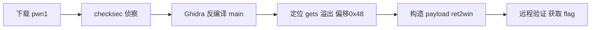

# ctf-demo — Final Report (Example)

> For the report structure, refer to `references/docs-generator/references/security-report-templates.md`.

## 1. Overview

| Item | Value |
|----|----|
| Target | pwn1 (https://ctf.example.com/challenges/pwn1) |
| Type | CTF pwn (stack overflow) |
| Result | ✅ flag captured |
| Time Consumed | ~1.5h |

## 2. Executive Summary

pwn1 is a 64-bit ELF without PIE/no canary, and main uses `gets()` to read a 0x40 buffer.
Overwrite the return address through offset 0x48 to call the win function within the program to obtain the flag. Remote verification succeeded.

## 3. Timeline

See `timeline.md` (5 stages: init → recon → static → exploit → wrap).

## 4. Findings

### F-01

- title: gets() stack overflow in main (ret2win)
- severity: high
- status: validated
- confidence: high
- evidence_ids: [E-001, E-002, E-003]
- location: pwn1:main — gets() into buf[0x40], return offset 0x48, no canary
- impact: Remote code execution as the pwn1 process user; flag disclosure in CTF context.
- repro_steps:
  1. Triage the binary (E-001)
  2. Confirm the overflow offset with a xKx0004xKx test (E-002)
  3. Send the ret2win payload against the remote service (E-003)
- remediation: Replace gets() with xKx0005xKx; enable canary, PIE and full RELRO; rely on ASLR.

## 5. Attack Path (Evidence → Finding → Path)

### P-01

- title: pwn1 ret2win solve path
- path_type: solve
- start: challenge binary download
- goal: flag capture
- steps:
  1. action: download and triage pwn1 — evidence: E-001 — finding: F-01 | none
  2. action: decompile main and confirm gets() overflow — evidence: E-002 — finding: F-01
  3. action: craft ret2win payload and verify remotely — evidence: E-003 — finding: F-01
- residual_risks: none (isolated CTF lab)



## 6. Reproduction

```bash
python3 exploit.py REMOTE
```

## 7. Repair Suggestions (If for Real Application)

- Use `fgets`/`read` to replace `gets`
- Enable canary + PIE + full RELRO
- Deploy ASLR (server-side)

## 8. Notes

- field-journal has been desensitized and precipitated (no real target information)